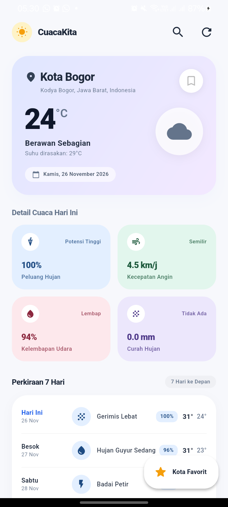
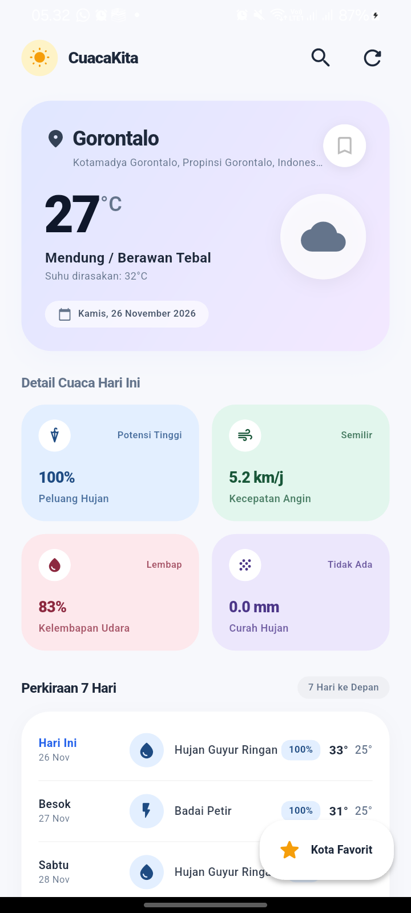

Nama: Nayla Octavia Ramadhani

NIM: H1D024115

Shift KRS: I

Shift Sekarang: E

---

# 🌤️ Responsi Flutter - Aplikasi Cuaca (Weather App)

Aplikasi ramalan cuaca modern yang dibangun menggunakan framework **Flutter** dengan bahasa pemrograman **Dart**, mengimplementasikan arsitektur **Model-View-ViewModel (MVVM)**, state management **Provider**, integrasi REST API dari **Open-Meteo**, serta penyimpanan lokal menggunakan **SharedPreferences**.

---

## ✨ Fitur Utama

### 1. 🏠 Home / Weather Screen
* **Informasi Lokasi & Tanggal:** Menampilkan nama kota terpilih, wilayah administrasi, negara, serta tanggal terkini yang diformat dalam Bahasa Indonesia.
* **Kondisi Cuaca Real-Time:** Menampilkan suhu saat ini (`temperature_2m`), suhu yang dirasakan (`apparent_temperature`), serta ikon & deskripsi kondisi cuaca berbasis standar WMO Weather Code.
* **Detail Cuaca Lengkap:**
  * 💧 Kelembapan Udara (`relative_humidity_2m`)
  * 💨 Kecepatan Angin (`wind_speed_10m`)
  * 🌧️ Curah Hujan (`precipitation`)
  * ☂️ Peluang Hujan Hari Ini (`precipitation_probability_max`)
* **Perkiraan Cuaca 7 Hari ke Depan (Daily Forecast):**
  * Tanggal dan nama hari ("Hari Ini", "Besok", dst.)
  * Ikon dan kondisi cuaca
  * Peluang hujan (%)
  * Suhu minimum (`temperature_2m_min`) dan maksimum (`temperature_2m_max`)
* **Interaksi Ramah Pengguna:**
  * Pull-to-refresh (`RefreshIndicator`) untuk memperbarui data seketika.
  * Tombol Bookmark / Star di kartu cuaca untuk menyimpan atau menghapus lokasi aktif dari daftar favorit.
  * Penanganan kondisi: Loading (skeleton/spinner), Error (tombol "Coba Lagi"), dan Empty state.

### 2. 🔍 Search & Location Screen
* **Pencarian Kota Real-Time:** Input teks pencarian yang langsung melakukan permintaan HTTP GET ke **Open-Meteo Geocoding API**.
* **Daftar Hasil Pencarian:** Menampilkan daftar kota lengkap dengan provinsi/negara dan tombol bookmark langsung pada item hasil pencarian.
* **Penyimpanan Kota Favorit:** Daftar kota favorit tersimpan yang dapat langsung dipilih kapan saja atau dihapus dengan satu ketukan.
* **Riwayat Pencarian:** Menyimpan histori kota yang pernah dicari & dipilih pengguna, dilengkapi opsi pembersihan ("Hapus Semua").

---

## 📁 Struktur Proyek

Proyek ini disusun rapi mengikuti standar pemisahan tanggung jawab (Separation of Concerns):

```text
lib/
├── core/
│   ├── constants/
│   │   ├── app_colors.dart         # Palet warna, gradien cuaca dinamis
│   │   └── weather_code_helper.dart# Pemetaan WMO Code ke teks bahasa Indonesia & Icon
│   └── theme/
│       └── app_theme.dart          # Konfigurasi ThemeData (Light & Dark theme)
├── models/
│   ├── location_model.dart         # Model data lokasi (id, name, lat, lon, country, json serializer)
│   └── weather_model.dart          # Model cuaca (CurrentWeather, DailyForecast, WeatherModel)
├── services/
│   ├── local_storage_service.dart  # Abstraksi SharedPreferences (Favorites & History)
│   └── weather_api_service.dart    # Klien HTTP REST API Open-Meteo (Forecast & Geocoding)
├── viewmodels/
│   ├── search_viewmodel.dart       # Pengelolaan state pencarian, riwayat, dan favorit
│   └── weather_viewmodel.dart      # Pengelolaan state cuaca terkini, refresh, loading, error
├── views/
│   ├── home/
│   │   ├── home_screen.dart        # Screen utama cuaca
│   │   └── widgets/
│   │       ├── current_weather_card.dart  # Kartu gradien cuaca utama
│   │       ├── daily_forecast_list.dart   # List perkiraan cuaca 7 hari
│   │       ├── weather_detail_grid.dart   # Grid 4 detail cuaca harian
│   │       └── weather_loading_view.dart  # Widget placeholder saat memuat
│   └── search/
│       └── search_screen.dart      # Screen pencarian, kelola favorit & riwayat
└── main.dart                       # Entry point aplikasi, inisialisasi MultiProvider & Locale
```

---

## 🏗️ Penerapan Arsitektur MVVM

Aplikasi ini mengadopsi pola arsitektur **Model-View-ViewModel (MVVM)** menggunakan paket `provider`:

```
┌─────────────────┐           ┌──────────────────────┐           ┌─────────────────┐
│      VIEW       │ ────────> │      VIEWMODEL       │ ────────> │ MODEL & SERVICE │
│                 │ (Actions) │                      │ (Calls)   │                 │
│  - HomeScreen   │           │ - WeatherViewModel   │           │ - WeatherModel  │
│  - SearchScreen │ <──────── │ - SearchViewModel    │ <──────── │ - LocationModel │
│  - UI Widgets   │  (State   │ (ChangeNotifier/     │  (Data/   │ - ApiService    │
│                 │  Updates) │  notifyListeners)    │   JSON)   │ - StorageService│
└─────────────────┘           └──────────────────────┘           └─────────────────┘
```

1. **Model (`lib/models/`)**:
   - Berisi kelas data murni (`LocationModel`, `CurrentWeather`, `DailyForecast`, `WeatherModel`).
   - Bertanggung jawab mem-parsing JSON dari respons API menjadi tipe data Dart yang aman (*type-safe*).

2. **ViewModel (`lib/viewmodels/`)**:
   - Mewarisi `ChangeNotifier` untuk mengelola logika bisnis dan *state*.
   - `WeatherViewModel`: Menyimpan state lokasi aktif, cuaca terkini, status loading, pesan error, dan status bookmark favorit.
   - `SearchViewModel`: Mengelola hasil query pencarian, daftar kota favorit tersimpan, dan riwayat penelusuran.
   - Memanggil `notifyListeners()` saat ada pembaruan data agar tampilan (View) merekonstruksi widget secara reaktif.

3. **View (`lib/views/`)**:
   - Antarmuka pengguna (UI) yang bersifat deklaratif.
   - Mendengarkan perubahan state ViewModel menggunakan widget `Consumer<WeatherViewModel>` dan `Consumer<SearchViewModel>`.
   - Tidak melakukan operasi HTTP atau penyimpanan lokal secara langsung di dalam View.

---

## 🌐 Implementasi API Open-Meteo

Aplikasi menggunakan dua endpoint utama dari REST API Open-Meteo:

### 1. Geocoding API (Pencarian Lokasi)
* **Endpoint:** `GET https://geocoding-api.open-meteo.com/v1/search`
* **Query Parameters:**
  * `name`: Kata kunci nama kota (contoh: "Jakarta", "Bandung")
  * `count`: `10`
  * `language`: `id` (Bahasa Indonesia)
  * `format`: `json`
* **Respons:** Daftar objek lokasi yang berisi `name`, `latitude`, `longitude`, `country`, dan `admin1`.

### 2. Weather Forecast API (Prakiraan Cuaca)
* **Endpoint:** `GET https://api.open-meteo.com/v1/forecast`
* **Query Parameters:**
  * `latitude` & `longitude`: Koordinat lokasi terpilih
  * `current`: `temperature_2m,relative_humidity_2m,apparent_temperature,precipitation,weather_code,wind_speed_10m`
  * `daily`: `weather_code,temperature_2m_max,temperature_2m_min,precipitation_probability_max`
  * `timezone`: `auto`

### 3. Pemetaan Field API ke Model Dart
| Data Cuaca | Field API Open-Meteo | Properti Model Dart |
|---|---|---|
| Suhu saat ini | `current.temperature_2m` | `CurrentWeather.temperature` |
| Kelembapan | `current.relative_humidity_2m` | `CurrentWeather.relativeHumidity` |
| Suhu yang dirasakan | `current.apparent_temperature` | `CurrentWeather.apparentTemperature` |
| Curah hujan | `current.precipitation` | `CurrentWeather.precipitation` |
| Kode kondisi cuaca | `current.weather_code` | `CurrentWeather.weatherCode` |
| Kecepatan angin | `current.wind_speed_10m` | `CurrentWeather.windSpeed` |
| Suhu maksimum harian | `daily.temperature_2m_max` | `DailyForecast.maxTemp` |
| Suhu minimum harian | `daily.temperature_2m_min` | `DailyForecast.minTemp` |
| Peluang hujan maksimum | `daily.precipitation_probability_max` | `DailyForecast.precipitationProbabilityMax` |

---

## 💾 Local Storage

Aplikasi mengimplementasikan **SharedPreferences** melalui `LocalStorageService`:
1. **Lokasi Terakhir (`last_selected_location`):** Menyimpan lokasi kota terakhir yang dibuka agar saat aplikasi ditutup dan dibuka kembali, cuaca kota tersebut langsung termuat.
2. **Lokasi Favorit (`favorite_locations`):** Menyimpan daftar kota favorit yang dibookmark pengguna (disimpan dalam format JSON list).
3. **Riwayat Pencarian (`search_history`):** Menyimpan hingga 10 lokasi terakhir yang pernah dicari dan dibuka oleh pengguna.

---

## 📸 Tampilan Layar (Screenshots)

| Home Screen (Kondisi Cuaca & Ramalan 7 Hari) | Search Screen (Pencarian & Kelola Lokasi) |
|:---:|:---:|
|  |  |

---

## 🚀 Panduan Menjalankan Aplikasi

Pastikan Flutter SDK sudah terpasang di sistem Anda.

1. **Unduh Dependensi:**
   ```bash
   flutter pub get
   ```

2. **Jalankan Uji Coba (Testing):**
   ```bash
   flutter test
   ```

3. **Jalankan Aplikasi:**
   ```bash
   flutter run
   ```

4. **Membangun APK (Opsional):**
   ```bash
   flutter build apk --release
   ```
